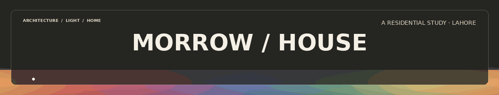
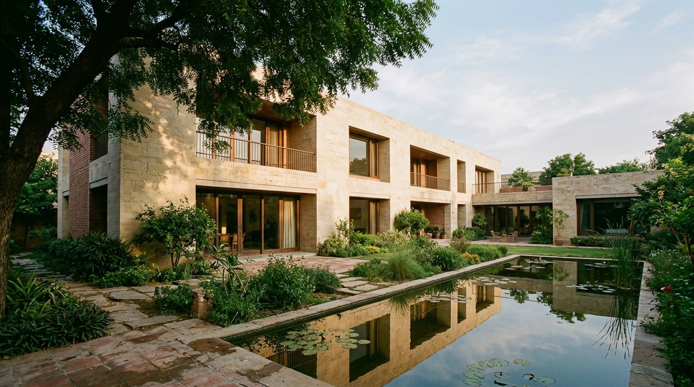

<div align="center">
  
  <br />
  <h1>MORROW / HOUSE</h1>
  <p><strong>A home, held in light.</strong><br />An editorial architecture portfolio and an interactive walk through a quieter residence.</p>
  <p>
    
  </p>
  <p><code>Next.js 16</code> &nbsp;·&nbsp; <code>React 19</code> &nbsp;·&nbsp; <code>TypeScript</code> &nbsp;·&nbsp; <code>Tailwind CSS 4</code> &nbsp;·&nbsp; <code>GSAP</code> &nbsp;·&nbsp; <code>Lenis</code> &nbsp;·&nbsp; <code>Three.js</code></p>
</div>

<br />

> A fictional residential design study set in Lahore, Pakistan. The bundled architecture imagery is original generated concept imagery—not photographs of a completed property. Replace the copy and pictures with your own work before presenting this as a real project.

## 01 / The feeling

Morrow House is a responsive, single-page architecture portfolio with a separate 3D walkthrough. Its visual language is intentionally restrained: parchment, limestone, brick, soft greens, generous margins, and two locally served typefaces. Motion is there to guide attention—not to compete with the work.



### What is included

- Full-bleed opening image with a considered type-led introduction.
- Multi-image editorial carousel with previous/next controls and progress count.
- Scrolling identity band and a rotatable Three.js axonometric house model.
- Working layer toggles for walls, floor, roof, columns, steps, and glazing.
- Two-part residence story, staggered room gallery, and a cinematic tour invitation.
- A separate `/tour/` experience with drag-to-look, keyboard movement, room details, a lighting/material toggle, camera reset, and full-screen control.
- Responsive navigation, custom pointer on mouse devices, smooth Lenis scrolling, GSAP reveals, reduced-motion support, and local fonts/images.
- Static export and a GitHub Pages workflow with automatic project-repository path handling.

<p align="center"></p>

## 02 / Get it running

**Requirements:** Node.js 20.9 or later and npm.

```bash
npm install
npm run dev
```

Open **http://localhost:3000**. The interactive walkthrough is at **http://localhost:3000/tour/**.

To check the production export:

```bash
npm run typecheck
npm run build
```

Next.js writes the static site to `out/`. The site does not need a database, environment variables, or a separate API server.

## 03 / Make it yours

Most of the words and image selections live in **`lib/content.ts`**:

- `siteContent` — name, location, year, email, page description, and hero copy.
- `gallerySlides` — the introductory image sequence.
- `storySlides` — the two architecture-study moments.
- `rooms` — the three room cards.

Replace the files in **`public/images/`** with your own photographs, then update the matching paths and alt text in `lib/content.ts`. Keep the same filenames for the quickest swap, or change both the file and its content entry. The layout uses `object-fit: cover`; choose images with a similar aspect ratio for the closest crop.

For component-specific changes:

| File | Edit |
| --- | --- |
| `app/page.tsx` | Landing-page sections and page order |
| `app/globals.css` | Color palette, type scale, spacing, responsive rules, and motion styling |
| `components/site-header.tsx` | Menu labels, navigation, and contact link |
| `components/house-model.tsx` | 3D structure and model-layer controls |
| `components/tour-experience.tsx` | Walkthrough scene, movement, details, and light toggle |
| `app/tour/page.tsx` | Walkthrough page metadata and composition |

The display fonts are local. Their SIL Open Font Licenses are included in `public/fonts/`.

## 04 / Controls

### Main page

- **Menu** opens the full-screen navigation; press **Escape** to close it.
- The photograph sequence and residence story have working previous/next controls.
- Drag the structure model to rotate it; scroll over it to zoom. Select a layer to show or hide it, or choose **Full view** to restore every layer.
- Room cards and the final invitation open the walkthrough.

### Walkthrough

| Input | Action |
| --- | --- |
| Drag | Look around the room |
| `W` `A` `S` `D` or arrow keys | Move through the space |
| `E` | Open or close room details |
| `Q` | Change the light/material palette |
| `R` | Reset the camera |
| Full-screen icon | Enter or exit full-screen mode |

On a phone, rotate to landscape for the intended walkthrough composition. If WebGL is unavailable, the scene falls back gracefully and the rest of the site remains usable.

<p align="center"></p>

## 05 / Publish on GitHub Pages

The included workflow at **`.github/workflows/deploy-pages.yml`** builds the static export and publishes it whenever `main` is updated. It reads the GitHub repository name during the build, so project-page paths such as `/your-repository/` are handled automatically.

1. Upload the **contents of this project folder** to a GitHub repository (keep the `.github` folder and its workflow).
2. In the repository, open **Settings → Pages** and set the source to **GitHub Actions**.
3. Open the **Actions** tab and wait for **Build and deploy to GitHub Pages** to finish.
4. Visit the Pages URL shown in the deployment job. For a project repository it will usually be `https://YOUR-USERNAME.github.io/YOUR-REPOSITORY/`.

The source project—not the generated `out/` folder—is what belongs in the repository. `out/` is produced by the workflow and is ignored by Git. GitHub Pages serves the static export; it does not run the Next.js development server.

For the careful browser-only, drag-and-drop upload steps (including how to split a project into batches when it has more than 100 files), see the separate owner guide prepared with this template. Keep that private guide out of a public repository.

## 06 / Project map

```text
app/                         Next.js App Router pages, metadata, and global styling
components/                  Navigation, reveals, image stories, and 3D experiences
lib/content.ts               The editable project copy and image manifest
lib/assets.ts                Public asset paths, including GitHub Pages base paths
public/images/               Original concept photographs used by the portfolio
public/fonts/                Local fonts and their SIL Open Font Licenses
public/readme/               Local animated README banner and section dividers
.github/workflows/           Static GitHub Pages deployment
```

<p align="center"></p>

## 07 / Build notes

- **Next.js App Router** generates a static export (`output: "export"`). There are no server-only routes or image-optimization endpoints.
- **GSAP + ScrollTrigger** handle the reveal and parallax choreography; **Lenis** is synchronized with ScrollTrigger for smooth scrolling.
- **Three.js** powers both the architectural model and the room walkthrough.
- **Tailwind CSS 4** is configured alongside a focused custom stylesheet for the art direction and responsive layouts.
- The rainbow banner and dividers above are small, local animated GIFs. The README does not rely on external animation or badge services.

## License and credits

The starter code is released under the MIT License. The typefaces are distributed under the SIL Open Font License; see the license text alongside the font files. The supplied concept images are generated placeholders for this fictional case study. Replace them with images you own or are licensed to use for your portfolio.

<div align="center">
  <br />
  <sub>Made for a quieter scroll. &nbsp;·&nbsp; Morrow House, 2026</sub>
  <br /><br />
  
</div>
